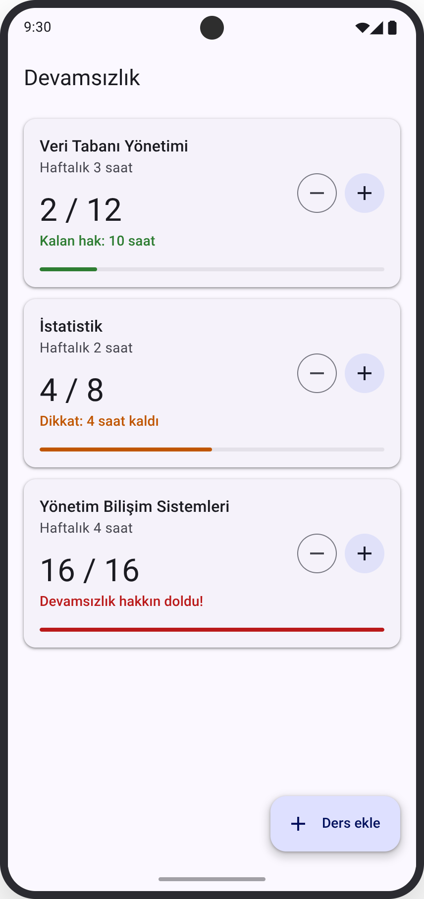
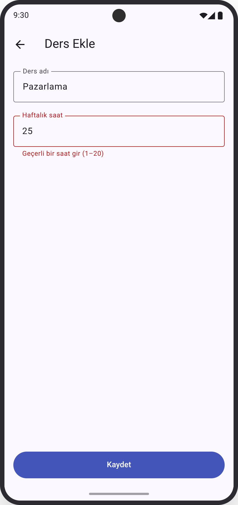
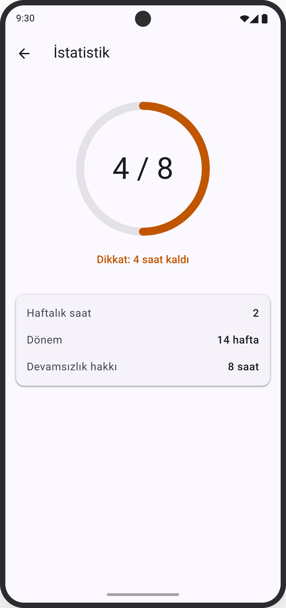

# Devamsızlık Takip Uygulaması

Üniversite öğrencilerinin ders devamsızlıklarını takip edip hakları dolmadan uyarı almalarını sağlayan, AI kod agent'larıyla canlı geliştirilmiş bir Flutter prototipi.

<p align="center">
  
  &nbsp;&nbsp;
  
</p>
<p align="center"><em>Solda Ders Listesi, sağda Ders Ekle ekranının tasarım referansı.</em></p>

## Eğitim bilgisi

| | |
|---|---|
| Eğitim | AI Destekli Flutter Geliştirme |
| Topluluk | Medipol MIS (Management Information Society) |
| Tarih | 25 Ekim 2026 |
| Eğitmen | Ahmet KAHRİMANOĞLU |
| Süre | 90 dakika |

Bu repo, eğitimde canlı olarak geliştirdiğimiz uygulamanın kendisi. Her commit eğitimdeki bir adıma karşılık geliyor; istediğin adımın koduna geri dönüp o noktadan kendin devam edebilirsin.

## Uygulama ne yapıyor?

İki ekranı var:

- **Ders Listesi:** Her ders bir kartta görünür: ders adı, haftalık saat, `kullanılan / hak` sayacı, durum yazısı ve ilerleme çubuğu. Kartın sağındaki **−1** ve **+1** butonlarıyla devamsızlık saatini güncellersin.
- **Ders Ekle:** Ders adı ve haftalık saati girip **Kaydet**'e basarsın; ders listeye 0 kullanılan saatle eklenir. Haftalık saat 1–20 arasında olmalıdır.

Veriler yalnızca bellekte tutulur; uygulamayı kapatıp açtığında başlangıçtaki üç örnek derse dönersin.

### İş kuralı

- Dönem 14 haftadır.
- **Devamsızlık hakkı = haftalık saat × 14 × 0,3**, aşağı yuvarlanır.

  | Haftalık saat | Hesap | Hak |
  |---|---|---|
  | 2 | 2 × 14 × 0,3 = 8,4 | 8 |
  | 3 | 3 × 14 × 0,3 = 12,6 | 12 |
  | 4 | 4 × 14 × 0,3 = 16,8 | 16 |

- Kullanılan saat sıfırın altına inmez.
- Her dersin üç durumu vardır. Renk tek başına anlam taşımasın diye her durumun bir yazısı da vardır:

  | Durum | Koşul | Renk | Kartta görünen yazı |
  |---|---|---|---|
  | Normal | Hakkın yarısından az kullanıldı | Yeşil | `Kalan hak: X saat` |
  | Dikkat | Hakkın yarısı veya fazlası kullanıldı | Turuncu | `Dikkat: X saat kaldı` |
  | Doldu | Hakkın tamamı kullanıldı | Kırmızı | `Devamsızlık hakkın doldu!` |

## Hızlı başlangıç

Bilgisayarında Flutter kurulu değilse önce [Flutter Kurulum Rehberi](docs/Flutter_Kurulum_Rehberi.pdf)'ni takip et. Rehber Windows, macOS ve Linux için gereken araçları, `flutter doctor` kontrolünü ve sık görülen hataları anlatıyor.

Eğitimde Flutter 3.47.8 (Dart 3.13.7) kullanıldı. `pubspec.yaml` en az Dart 3.13.7 istiyor; daha eski bir Flutter sürümün varsa `flutter upgrade` ile güncelle.

```bash
git clone https://github.com/ahmetkah/discontinuity.git
cd discontinuity
flutter pub get
flutter run
```

`flutter run` birden fazla cihaz bulursa hangisini kullanacağını sorar. Bir emülatör, simülatör ya da USB ile bağlı bir telefon açık olmalı; `flutter devices` ile neyin bağlı olduğunu görebilirsin. Emülatör oluşturmayı ve telefonu USB ile bağlamayı [kurulum rehberinde](docs/Flutter_Kurulum_Rehberi.pdf) bulabilirsin.

## Eğitim materyalleri

**Okuma sırası:** önce [Flutter_Kurulum_Rehberi.pdf](docs/Flutter_Kurulum_Rehberi.pdf), sonra [Ogrenci_Akisi.pdf](docs/Ogrenci_Akisi.pdf), ayrıntı için [ADIMLAR.md](docs/ADIMLAR.md).

| Dosya | Açıklama |
|---|---|
| [docs/Flutter_Kurulum_Rehberi.pdf](docs/Flutter_Kurulum_Rehberi.pdf) | Windows, macOS ve Linux için gereken araçları, `flutter doctor` kontrolünü ve sık görülen hataları anlatan kurulum rehberi. |
| [docs/Ogrenci_Akisi.pdf](docs/Ogrenci_Akisi.pdf) | Ders öncesi, ders ve ders sonrasında takip edeceğin, yazdırılabilir kısa akış: her adım için yapılacaklar, prompt numarası, "bitti" ölçütü ve commit. |
| [docs/ADIMLAR.md](docs/ADIMLAR.md) | Her adımın nedenini, prompt'unun tam metnini ve kodda neyin değiştiğini commit farkıyla anlatan ayrıntılı rehber. |
| Sunum (S1–S24) | Eğitmenin paylaştığı bağlantı. TODO: bağlantı eklenecek |
| [docs/prompts/Prompt_0_Claude_Design_dersten_once.txt](docs/prompts/Prompt_0_Claude_Design_dersten_once.txt) | Ders öncesinde `design/` klasöründeki üç ekran tasarımını hazırlamak için yazılan prompt. |
| [docs/prompts/Prompt_1_MVP.txt](docs/prompts/Prompt_1_MVP.txt) | Problemi tanımlayıp AI'dan en fazla 4 özellikli bir MVP önerisi isteyen prompt. |
| [docs/prompts/Prompt_2_AGENTS_md.txt](docs/prompts/Prompt_2_AGENTS_md.txt) | Ürün, iş kuralı, teknik kısıtlar ve çalışma şeklini içeren `AGENTS.md` dosyasını oluşturan prompt. |
| [docs/prompts/Prompt_3_Plan.txt](docs/prompts/Prompt_3_Plan.txt) | MVP'yi her biri çalışan bir uygulamayla biten en fazla 5 adıma bölen planı isteyen prompt. |
| [docs/prompts/Prompt_4_Proje_Yapisi.txt](docs/prompts/Prompt_4_Proje_Yapisi.txt) | Boş Flutter projesinin klasör yapısını yeni başlayan biri için açıklatan prompt. |
| [docs/prompts/Prompt_5_Liste_ve_Sayac.txt](docs/prompts/Prompt_5_Liste_ve_Sayac.txt) | Ders veri modelini ve +1/−1 sayaçlı Ders Listesi ekranını yaptıran prompt. |
| [docs/prompts/Prompt_6_Ders_Ekleme.txt](docs/prompts/Prompt_6_Ders_Ekleme.txt) | Ders Ekle ekranını ve `Navigator.push`/`pop` ile listeye dönüşü yaptıran prompt. |
| [docs/prompts/Prompt_7_Hata_Aciklama.txt](docs/prompts/Prompt_7_Hata_Aciklama.txt) | Boş saat alanıyla Kaydet'e basınca oluşan hatayı kodu değiştirmeden açıklatan prompt. |
| [docs/prompts/Prompt_8_Hata_Duzeltme.txt](docs/prompts/Prompt_8_Hata_Duzeltme.txt) | Ders Ekle formuna doğrulama ve hata mesajları ekleten prompt. |
| [docs/prompts/Prompt_9_Tasarim.txt](docs/prompts/Prompt_9_Tasarim.txt) | Ders Listesi ekranını tasarımla karşılaştırıp yalnızca ilk farkı düzelttiren prompt. |
| [docs/prompts/Prompt_10_Refactoring.txt](docs/prompts/Prompt_10_Refactoring.txt) | Davranışı değiştirmeden ders kartını `CourseCard` widget'ına taşıtan ve durum hesabını sadeleştiren prompt. |
| [docs/prompts/Prompt_11_Codex_Inceleme.txt](docs/prompts/Prompt_11_Codex_Inceleme.txt) | Projeyi ikinci bir agent'a (Codex) `AGENTS.md`'ye göre inceletip en önemli 3 bulguyu isteyen prompt. |
| [docs/prompts/Prompt_12_Bulgu_Duzeltme.txt](docs/prompts/Prompt_12_Bulgu_Duzeltme.txt) | İncelemeden gelen tek bir bulguyu, başka hiçbir şeye dokunmadan düzelttiren prompt. |

Prompt'lardaki `[... buraya yapıştır]` kısımları şablon; kendi denemende o anki hata mesajını ya da bulguyu yapıştırman gerekiyor.

## Adım adım geliştirme

Uygulama 9 adımda geliştirildi. Kod üreten her adımın sonunda bir commit atıldı ve o commit bir etiketle işaretlendi. Prompt numaraları [docs/prompts/](docs/prompts/) klasöründeki dosyalarla aynı.

| Adım | Slayt | Prompt(lar) | Commit | Etiket | Hash | Ne değişti |
|---|---|---|---|---|---|---|
| 1 · Problem → MVP | S12 | PROMPT 1 | — | — | — | AI ile MVP seçildi: ders ekleme, ders listesi, +1/−1 sayaç ve renkli uyarı. Kod yazılmadı. |
| 2 · Context, plan ve tasarım | S13 | PROMPT 2–3 | — | — | — | `AGENTS.md` oluşturuldu, `design/` görselleriyle birlikte adım planı çıkarıldı. Kod yazılmadı. |
| 3 · Proje ve yapı | S14 | PROMPT 4 | COMMIT 1: “Boş proje oluşturuldu.” | `adim-3` | `beecf44` | Boş Flutter projesi (Hello World), `AGENTS.md` ve `design/` görselleri ilk commit'e girdi. |
| 4–5 · Model, liste, state + Ders ekleme ve navigation | S15–S16 | PROMPT 5–6 | COMMIT 2: “Ders Listesi sayfası ve Ders ekleme sayfası” | `adim-5` | `03935af` | `Ders` modeli, iş kuralı, +1/−1 sayaçlı Ders Listesi ve `Navigator` ile açılan Ders Ekle ekranı. |
| 6 · Hata ve debugging | S17 | PROMPT 7–8 | COMMIT 3: “Form doğrulaması” | `adim-6` | `a16e659` | Boş saatle Kaydet'te oluşan `FormatException` çözüldü; forma doğrulama ve hata mesajları eklendi. |
| 7 · Arayüzü tasarıma yaklaştır | S18 | PROMPT 9 | COMMIT 4: “Tasarıma yaklaştırma” | `adim-7` | `b9f679e` | Durum renkleri `design/screen1.png`'deki renklerle değiştirildi. |
| 8 · Refactoring ve inceleme | S19 | PROMPT 10–12 | COMMIT 5: “Refactoring” | `adim-8` | `43dcec7` | Ders kartı `lib/course_card.dart` içindeki `CourseCard` widget'ına taşındı, durum hesabı okunur hale getirildi. |
| 9 · Son tur | S20 | — | — | — | — | `git log` ile geliştirme geçmişi birlikte gözden geçirildi. |

Adımları uygularken [docs/Ogrenci_Akisi.pdf](docs/Ogrenci_Akisi.pdf)'i takip et. Her adımın nedenini, prompt'un tam metnini ve değişen dosyaları [docs/ADIMLAR.md](docs/ADIMLAR.md)'de bulabilirsin.

### Bir adımın koduna gitmek

Örneğin form doğrulamasının eklendiği Adım 6'nın koduna gitmek için:

```bash
git checkout adim-6
flutter run
```

Güncel koda geri dönmek için:

```bash
git checkout master
```

Bilmen gereken birkaç şey:

- Bir etikete geçtiğinde Git seni "detached HEAD" durumuna alır. Kodu inceleyip çalıştırabilirsin; o noktadan değişiklik yapıp saklamak istersen önce kendine bir dal aç: `git switch -c benim-denemem`.
- Bu README ve `docs/` klasörü son commit'lerden sonra eklendi; eski bir adıma geçtiğinde görünmezler. `master`'a dönünce geri gelirler.
- Etiketler arasındaki farkı görmek için `git diff adim-5 adim-6` kullanabilirsin.

## Proje yapısı

Kendi yazdığımız kod yalnızca `lib/` altında. `android/` ve `ios/` klasörleri Flutter'ın oluşturduğu platform dosyalarıdır, eğitim boyunca dokunulmadı.

| Dosya | Görevi |
|---|---|
| [lib/main.dart](lib/main.dart) | Uygulamanın giriş noktası (`main`). `Ders` veri modelini ve iş kuralını (`hak`, `kalan`, `durum`), `DersDurumu` enum'unu, Ders Listesi ekranını (`DersListesiEkrani`) ve doğrulamalı Ders Ekle formunu (`DersEkleEkrani`) içerir. |
| [lib/course_card.dart](lib/course_card.dart) | Listedeki her dersi çizen `CourseCard` widget'ı: sayaç, durum rengi ve yazısı, ilerleme çubuğu, −1/+1 butonları. |

Kökteki diğer önemli dosyalar:

| Dosya / klasör | Görevi |
|---|---|
| [AGENTS.md](AGENTS.md) | AI kod agent'ına verilen proje kuralları: ürün, iş kuralı, teknik kısıtlar, kapsam dışı konular ve çalışma şekli. |
| [design/](design/) | Ekran tasarımları: [screen1.png](design/screen1.png) Ders Listesi, [screen2.png](design/screen2.png) Ders Ekle, [screen3.png](design/screen3.png) Ders Detayı (sonraki sürüm hedefi). |
| [pubspec.yaml](pubspec.yaml) | Proje adı, Dart SDK sürümü ve bağımlılıklar. Harici paket yok. |
| [docs/](docs/) | Eğitim materyalleri ve prompt'lar. |

## Ders sonrası alıştırmalar

Aşağıdaki alıştırmaları eğitimdeki yöntemle yapmanı öneririm: önce plan iste, küçük bir adım uygulat, sonucu kendin test et, sonra commit at.

### 1. Ders Detayı ekranı



[design/screen3.png](design/screen3.png)'deki Ders Detayı ekranını yap. Listedeki bir karta dokununca açılsın; AppBar'da ders adı, ortada büyük bir dairesel ilerleme göstergesi (`CircularProgressIndicator`) ve `kullanılan / hak`, altında durum yazısı, en altta da haftalık saat, dönem (14 hafta) ve devamsızlık hakkını gösteren bilgi satırları olsun.

Bu ekran şu an `AGENTS.md`'de "Kapsam dışı" listesinde. Agent'a iş vermeden önce `AGENTS.md`'yi güncellemeyi unutma; yoksa agent bu kurala uyup işi reddedebilir.

<br clear="right">

### 2. Kalıcı veri

Şu an uygulamayı kapatınca eklediğin dersler ve sayaçlar kayboluyor. Verilerin cihazda saklanmasını sağla.

Bunun için büyük ihtimalle bir paket gerekecek; oysa `AGENTS.md` hem "Harici paket ekleme" diyor hem de kalıcı veriyi kapsam dışı sayıyor. Önce AI'dan seçenekleri artıları ve eksileriyle karşılaştırmasını iste ("Henüz kod yazma."), kararı sen ver, sonra `AGENTS.md`'yi güncelle.

### 3. İş kuralı için birim testi

İş kuralı `lib/main.dart` içindeki `Ders` sınıfında. Bir `test/` klasörü açıp en az şu durumları test et:

- Hak hesabı: 2 saat → 8, 3 saat → 12, 4 saat → 16.
- Durum sınırları (3 saatlik ders, hak 12): 5 saat kullanıldıysa normal, 6 saat dikkat, 12 saat doldu.
- Hak 8 olan bir derste 4 saat kullanıldıysa dikkat (tam yarı sınırı).

Testleri şu komutla çalıştırırsın:

```bash
flutter test
```

İpucu: `Ders` sınıfına testten `import 'package:discontinuity/main.dart';` ile ulaşabilirsin. "Kullanılan saat sıfırın altına inmez" kuralı modelde değil, ekranın `_azalt` metodunda; onu da test etmek istersen önce bu kuralı modele taşımayı düşün.

## Lisans

<!-- TODO: Repoda henüz LICENSE dosyası yok. Öğrencilerin kodu kullanabilmesi için bir lisans eklenmesi öneriliyor (ör. MIT). -->
Bu repo için henüz bir lisans belirlenmedi.
